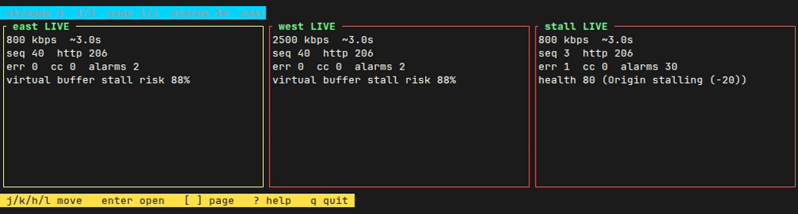

# streamtop

Terminal monitor for live HLS, DASH, and IPTV streams: segment timing, codec data read from the wire, SCTE-35 markers, and health scores, without a browser or GUI player.

[](https://crates.io/crates/streamtop)
[](https://github.com/Jorji49/streamtop/releases/latest)
[](LICENSE)


## Install

```bash
cargo install streamtop                          # or: cargo binstall streamtop
brew tap Jorji49/tap && brew install streamtop   # macOS and Linux
docker run -it --rm ghcr.io/jorji49/streamtop:latest <URL>
```

Prebuilt binaries for Linux (x86_64 and arm64, glibc and musl), macOS (Apple Silicon and Intel), and Windows x86_64 are on [GitHub Releases](https://github.com/Jorji49/streamtop/releases/latest). Arch Linux, source builds, and the Windows status are in the [install guide](https://jorji49.github.io/streamtop/install.html).

## Usage

```bash
# Live dashboard for HLS or DASH
streamtop "https://example.com/master.m3u8"

# IPTV list: channel picker
streamtop ./channels.m3u

# Several streams in one grid. Enter opens one stream.
streamtop --grid URL1 URL2 URL3
```



Recording of `streamtop --grid` on three local ffmpeg HLS test streams; the stall playlist is frozen and its segments are delayed.

More commands:

```bash
# MPEG-TS TR 101 290 checks and SEI metadata
streamtop "https://example.com/manifest.mpd" --tr101290 --probe-sei

# Check every entry: table, JSON or CSV, a playlist of working ones, exit 1 on dead
streamtop check ./channels.m3u --alive-out working.m3u --fail-on-dead

# Decode one SCTE-35 cue (Base64, hex, or an HLS tag line)
streamtop scte35 "/DAvAAAAAAAA///wFAVIAACPf+/+c2nALv4AUsz1AAAAAAAKAAhDVUVJAAABNWLbowo="

# Headless PASS/FAIL for CI (JSON or SARIF)
streamtop <URL> --summary --summary-format json --timeout 10

# Prometheus /metrics on 127.0.0.1:9184
streamtop <URL> --prometheus

# Save a redacted evidence bundle when a stall or continuity error fires
streamtop <URL> --evidence-dir ./evidence --evidence-segments 2
```

Input can be an HLS playlist (`.m3u8`), a DASH manifest (`.mpd`), an IPTV channel list (`.m3u`, `.json`, `.yaml`), or a WHEP endpoint. `streamtop --help` lists all options. `streamtop completions <bash|zsh|fish|elvish|powershell>` prints a completion script and `streamtop man` prints the man page.

## What it checks

* HLS (including LL-HLS parts) and MPEG-DASH, live and VOD
* Segment DNS / TCP / TLS / TTFB timing and CDN HIT/MISS for 12 CDNs
* ABR ladder versus the bitstream: resolution, FPS, GOP, audio
* TR 101 290 P1/P2 on MPEG-TS, SEI captions and HDR metadata
* IPTV playlist checks with `streamtop check`
* SCTE-35 in HLS tags and DASH `emsg`, with mismatch detection
* Side-by-side compare, a multi-stream grid, and multi-CDN live-edge skew
* Exports: HTML/JSON reports, HAR, curl, SARIF, Grafana dashboard
* Prometheus, OpenTelemetry, webhooks, a multi-stream agent, and opt-in alarm evidence bundles

streamtop reads headers and the first bytes of each segment. It does not decode media, and it does not take SRT, RTMP, or UDP input. See [Limits](https://jorji49.github.io/streamtop/limits.html) and how it compares with [TSDuck, ffprobe, threefive, and iptv-checker](https://jorji49.github.io/streamtop/comparison.html).

## More

[Documentation](https://jorji49.github.io/streamtop/) | [IPTV checking](https://jorji49.github.io/streamtop/iptv.html) | [CI](https://jorji49.github.io/streamtop/ci.html) | [Changelog](CHANGELOG.md)

Listed in [awesome-ratatui](https://github.com/ratatui/awesome-ratatui) and [awesome-rust](https://github.com/rust-unofficial/awesome-rust).

Bug reports and pull requests are welcome. See [CONTRIBUTING.md](CONTRIBUTING.md). Questions and ideas go to [Discussions](https://github.com/Jorji49/streamtop/discussions).

## License

[MIT](LICENSE).
