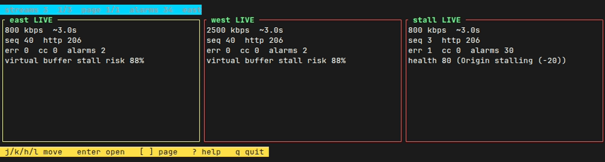

# Grid and evidence

## Multi-stream grid

```bash
streamtop --grid https://a.example/live.m3u8 https://b.example/live.m3u8
streamtop https://a.example/live.m3u8 https://b.example/manifest.mpd
streamtop --agent agent.toml --grid
```



Recording of `streamtop --grid` on three local ffmpeg HLS test streams; the stall playlist is frozen and its segments are delayed.

Two or more URLs open the grid even without `--grid`. `--grid` with one URL still opens a one-tile grid. `--agent CONFIG --grid` uses each `[[streams]]` entry (its own headers, interval, probe flags, and webhook) instead of the headless metrics server.

Each tile shows:

* status (`LIVE`, `VOD`, `DEGRADED`, `ERROR`)
* bitrate (download rate, or the selected ladder bitrate)
* segment latency
* error count, continuity-counter count, and the latest alarm line

| Key | Action |
|-----|--------|
| arrows, `h` `j` `k` `l` | Move between tiles |
| Enter | Open that stream in the normal dashboard |
| `q`, Esc | On the dashboard, return to the grid. On the grid, quit |
| `[` `]` | Previous or next page |
| `g`, `G` | First or last tile |
| `?` | Help |

An 80x24 terminal fits two columns and a few rows (about six tiles) and scrolls. A terminal narrower than one tile, or shorter than a tile, switches to a one-line list and still scrolls. The grid accepts at most 64 streams, the same cap as the agent.

`--grid` does not combine with `--compare`, `--multi-cdn`, `--vod`, `--summary`, `--audit`, `--export`, `--prometheus`, or `--budget-*`.

## Evidence on alarm

Evidence is off until you set a directory:

```bash
streamtop URL --evidence-dir ./evidence
streamtop URL --evidence-dir ./evidence --evidence-segments 2 --tr101290
streamtop --agent agent.toml
```

The same keys work in `~/.config/streamtop/config.toml` and in the agent file: `evidence_dir`, `evidence_segments`, `evidence_max_bytes`, `evidence_segment_bytes`, `evidence_min_interval_secs`, `evidence_max_dumps`. CLI flags override the file.

A bundle is written when any of these happen:

* a stall (download-to-duration, part RTF, buffer stall risk at least 80%, segment TTFB at least 2500 ms, or a health deduction that says stall)
* a continuity-counter error (`P1_CC` / `ERR_TR101290_CC_ERROR`, or the TR 101 290 counter going up)
* another alarm: error-severity finding, HTTP 5xx, stream error, or an ad-marker mismatch

Each bundle is a directory:

```text
evidence/20261109T143012Z_stall_primary/
  bundle.json
  manifests/001.m3u8
  manifests/001.meta.json
  segments/001.meta.json
  segments/001.bin          # only with evidence_segments > 0
```

`bundle.json` is `streamtop.evidence.v1`. Manifest files are the last few playlists or MPDs. Segment metadata is the request URL, HTTP status, TTFB, download time, byte count, and request/response headers. `Authorization`, `Cookie`, and other secret headers are replaced with `[REDACTED]`. Query tokens and URL userinfo are redacted in the saved text, including inside playlists.

`--evidence-segments N` (0 by default, maximum 8) also stores the bytes streamtop already downloaded, truncated to `--evidence-segment-bytes` (default 256 KiB, maximum 4 MiB). With the default range probe that is the probe window, not the whole segment. `--full-segment` can save more, still under the cap.

Limits, so a burst cannot fill the disk:

| Knob | Default | Hard maximum |
|------|---------|--------------|
| `--evidence-max-bytes` | 32 MiB total | 1 GiB |
| `--evidence-max-dumps` | 32 bundles | 500 |
| `--evidence-min-interval` | 30 seconds per alarm kind per stream | at least 1 second |
| manifests kept | 4, each truncated to 64 KiB | |
| one bundle | at most 2 MiB (older bodies are dropped first) | |

The same stall does not write again until the interval passes. A continuity error in that window still gets its own bundle. When the byte or dump cap is reached, streamtop prints one line and skips further bundles.
